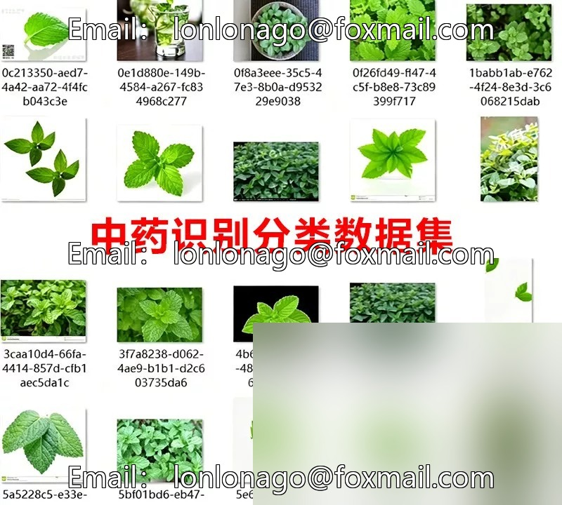
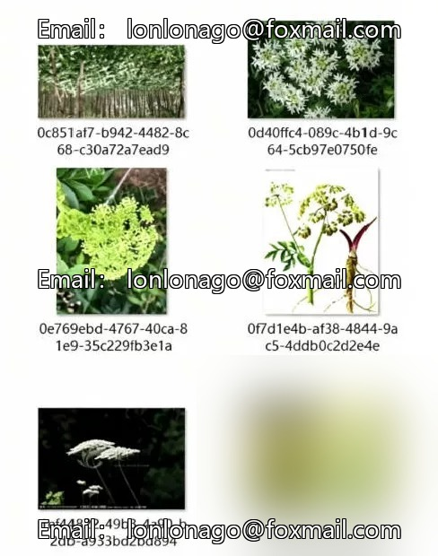
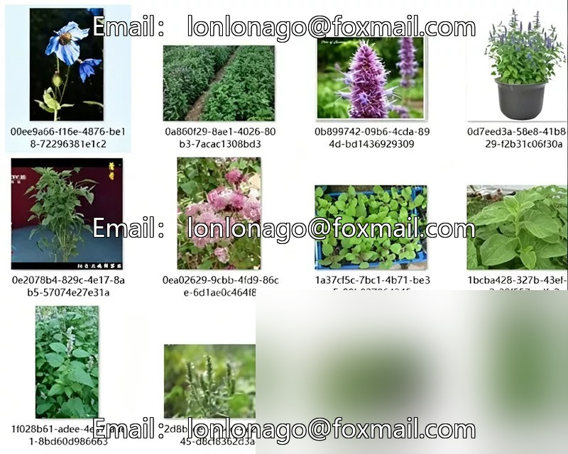

# Chinese medicinal drug recognition classification dataset of 54 types of Chinese medicinal drugs

## Body

Medicinal Chinese recognition classification dataset of 54 classes; folders are organized by categories, totaling 8525 images, with each category having approximately 100 to 300 images.

Agastacherugosa → Halmemoorella
Angelica → Angelica root
Boheye → Mint leaves
Bosipopona → Bupleurum → Acheonia
Cangerzi
Chenopodiumalbum → Comfrey (gray mustard)
Commelina_communis → Commelina communis
Dandelions → dandelion
Dragon Lantern Grass
Eichhorniacrassipes → Windmill seaweed (water hemp)
Feipeng → Foible
Gardenia
……

web-based shipment, can be directly photographed and shipped.

The dataset covers 54 categories of traditional Chinese medicine recognition, totaling 8,525 images organized into folders by category; the image text includes recognition objects and folder structure details.

<!-- AI_ENRICHED -->

## Images

## Payment

Here is a pay link on Stripe ( https://buy.stripe.com/3cs8yP7sY87d0vu9AB ). Please contact me lonlonago@foxmail.com after funding $89, and I will send you a complete data files , thank you!

